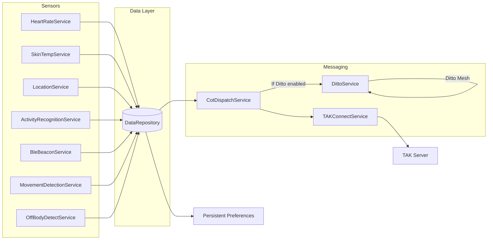

# WearTAK-CIV

## 1. Overview

### What is WearTAK?
WearTAK is a WearOS based client for a TAK Server. It is built specifically for the Samsung Galaxy Watch 7 & Ultra and provides a standalone, secure, hands-free sensor hub that streams live position and physiological metrics into Team Awareness Kit (TAK). This branch is specifically the Civilian version (WearTAK-Civ).

### Key Value Propositions
- **Direct to TAK Server** – Direct TLS socket connection to TAK Server with credentials or certificates.
- **Location Tracking** – Monitors wearer's location using GPS and Google fused location services.
- **Physio Monitoring** – Collects and transmits heart rate, skin/ambient temperature, steps, calories, elevation, and floors to TAK.
- **Marker Drop** – Drop markers on location with just two clicks.
- **Manual SOS Alerts** – Trigger SOS alerts on TAK Server in two clicks.
- **Automatic Alerting** – Uses algorithms like Karvonen to send emergency notifications for high exertion based on heart rate reserve and resting heart rate.
- **Stand-Alone Watch** – No tethered phone required (calls, SMS, cell data, and configurations run on-device).
- **Dynamic Reporting Rates** – Increases update rate when moving or off-Wi-Fi, slows down on “home” SSID to save battery.
- **Off-Grid Mesh (Ditto)** – Shares PLI, markers, and SOS over BLE/Wi-Fi between nearby Ditto nodes.
- **Knox MDM Managed** – Update settings for an entire fleet via Managed Configs.
- **iBeacon Integration** – Provides coarse indoor positioning when beacons and 3-D coordinates are provisioned.
- **TAK Chat** – Send and receive chat messages from TAK devices (online only; no offline chat).
- **Activity Monitoring** – Detect and classify activities using Google's Mobile Services (Still, walking, running, on foot, in vehicle, on bicycle)

### Supported Hardware

| Device                     | OS                  | Connectivity       |
|----------------------------|---------------------|--------------------|
| Samsung Galaxy Watch 7  | Wear OS 5 (API 34) | LTE / Wi-Fi / BLE |
| Samsung Galaxy Watch Ultra  | Wear OS 5 (API 34) | LTE / Wi-Fi / BLE |

---

## 2. Architecture Summary

### Layered Components

| Layer                   | Key Classes                                                                                                    | Responsibility                                     |
|-------------------------|----------------------------------------------------------------------------------------------------------------|---------------------------------------------------|
| **Main Logic**     | `presentation/MainActivity.kt`                                                                                     | Load Settings, Launch Services, UI, Handle Mgd Config updates, license, etc |
| **App Bootstrap**       | `WearTakApplication.kt`, `WearTakInitOnBoot.kt`, `WearTakInitOnUpdate.kt`                                     | DI setup, start critical services on boot/update  |
| **Presentation UI**     | `presentation/*.kt`, `tile/MainTileService.kt`, `complication/*ComplicationService.kt`                        | Activities, tiles, complications                  |
| **Managers**            | `manager/NetworkManager.kt`, `SMSManager.kt`                                                                 | Encapsulate low-level network/SMS operations      |
| **Repositories**        | `data/DataRepository.kt`, `data/HealthServicesRepository.kt`                                                 | Single source of truth (Kotlin Flow)              |
| **Services – Sensors & State** | `HeartrateService.kt`, `SkinTempService.kt`, `MovementDetectionService.kt`, `OffBodyDetectService.kt`, `PassiveDataService.kt`, `BleBeaconService.kt` `ActivityRecognitionService.kt`| Collect sensor, health, and iBeacon data |
| **Services – Comms**    | `TAKConnectService.kt`, `CotDispatchService.kt`, `DittoService.kt`, `ChatService.kt`, `LicenseManager.kt`    | Transmit/receive CoT, mesh PLI, chat, licensing   |
| **Services – Power/Safety** | `BatteryService.kt`, `PowerManagerService.kt`, `CustomAccessibilityService.kt`, `SosActivity.kt`         | Battery optimization, SOS detection, accessibility hooks |
| **Domain Events**       | `events/*.kt` (e.g., `LocationRcvd`, `TakChatEvent`)                                                         | Typed event bus between layers                    |
| **Utilities**           | `Utils.kt`, `NetworkUtils.kt`                                                                                | Common helpers                                    |

### Data Flow



<!-- TODO: add secondary diagram for iBeacon → Fusion → DataRepository -->

---

## 3. Data Handling & Storage

| Data                         | Source                  | Classification       | Transit                            | Units / System         | DataType                 |
|------------------------------|-------------------------|--------------|------------------------------------|------------------------|--------------------------|
| Heart Rate                   | Google Health Services         |  Integer  | `HeartrateService → CoT → TAK`     | beats per minute (bpm)  | Integer                 |
| Location (GNSS)    | Google Location Services    | Location Obj | `LocationService → CoT / mesh`   | World Geodetic System 84 (WGS84)    | Location Object  | 
| Daily Metrics  | Google Health Services      | DailyMetrics Obj      | `ActivityRecognitionService → DataRepo → CoT `         | Steps (Long), Calories (Dbl), Floors (Dbl), Elevation (meters)  | DailyMetrics Obj |
| Skin & Ambient Temp  | Samsung Health Sensor   | HealthTracker.TrackerEventListener   | `SkinTemp → DataRepo → CoT`    | Degree F        | Float | 
| SOS                          | UI / gesture            | Composable `onClick` | `SosActivity → EventBus -> CotDispatch`    | None                   | Strings | 
| Managed Config               | App Restrictions `res/xml/app_restrictions.xml`               | `RestrictionsManager` in MainActivity.kt         | `Knox MDM → MainActivity → DataRepo`             | EncryptedSharedPrefs   |  string, bool, bundle, bundle_array   | 
| Chat Messages  | TAK Server via `TAKConnectService`   |  Socket `InputStreamReader`  | `TAK Server → TAKConnectService → EventBus → ChatService → ChatActivity`    | ChatRoom data class        | Custom Classes | 


### Security
- TLS 1.3 with pinned certificates (`TAKConnectService.kt`).
- Knox MDM enforces device attestation and remote wipe.

---

## 4. Build & Deployment

### Prerequisites
```bash
sdkmanager "platforms;android-34" "build-tools;34.0.0"
export JAVA_HOME=$(/usr/libexec/java_home -v 17)
```

### Fast Build & Install
```bash
./gradlew assembleDebug
adb install -r app/build/path/to/debug/apk
adb shell am start -n com.aitech.weartak_civ/.presentation.MainActivity
```
### Build Types
Currently, we build `armeabi-v7a` and `universal`. For the Galaxy watches, we use `armeabi-v7a`  

### Developer Switches

#### ADB Commands
| Action                  | Command                                       |
|-------------------------|-----------------------------------------------|
| Enable Accessibility for WearTAK | `adb shell cmd settings put secure enabled_accessibility_services "com.aitech.weartak_civ/.service.CustomAccessibilityService"` |
| Grant app permission             | `adb shell pm grant $PACKAGE $PERM`   |
| Get debug APK Path   | ` ls $(find app/build/outputs/apk/debug -type f -name "*arm*.apk")` | 
| Start WearTAK  | `adb shell am start -n com.aitech.weartak_civ/.presentation.MainActivity` |
| Stop WearTAK   | `adb shell cmd activity force-stop com.aitech.weartak_civ/.presentation.MainActivity` |

#### Logging to a file on device

Import file logging utility in Utils.kt & java File:
```kotlin
import com.aitech.weartak_civ.Utils
import java.io.File
```

```kotlin
private val LOG_FILENAME = "yourLogFileName.log"     // give the file a name
private val logFile: File by lazy {                  // Make sure the log file's folder exists
    File(filesDir, LOG_FILENAME).apply {
        if (!exists()) parentFile?.mkdirs()
    }
}

writeToLogFileLocation(logFile, "---------------New Session of ExampleService ---------------")
writeToLogFileLocation(logFile, " -- This will be the next line!
```

##### Following the logs live:
`adb shell`

In adb shell: 
`run-as com.aitech.weartak_civ`

Follow the log:
`tail -f files/yourLogFileName.log`

Depending on how logs are written, they can appear in other locations. Another directory to check is:
`ls /storage/emulated/0/Android/data/com.aitech.weartak_civ/files/`

#### App Runtime Permissions Script:
```bash
#!/usr/bin/env bash
set -euo pipefail
IFS=$'\n\t'

# Package name
PACKAGE="com.aitech.weartak_civ"
ACCESSIBILITY_SERVICE="com.aitech.weartak_civ/.service.CustomAccessibilityService"

# Runtime perms
PERMISSIONS=(
  "android.permission.ACCESS_FINE_LOCATION"
  "android.permission.NEARBY_WIFI_DEVICES"
  "android.permission.POST_NOTIFICATIONS"
  "android.permission.READ_PHONE_STATE"
  "android.permission.ACTIVITY_RECOGNITION"
  "android.permission.BODY_SENSORS"
  "android.permission.SEND_SMS"
  "android.permission.ACCESS_BACKGROUND_LOCATION"
)

echo "▶ Granting runtime permissions to ${PACKAGE}..."
for PERM in "${PERMISSIONS[@]}"; do
  printf " • %s... " "${PERM}"
  if adb shell pm grant "${PACKAGE}" "${PERM}"; then
    echo "OK"
  else
    echo "FAILED" >&2
    exit 1
  fi
done

echo "▶ Enabling Accessibility service: ${ACCESSIBILITY_SERVICE}"
adb shell cmd settings put secure enabled_accessibility_services "${ACCESSIBILITY_SERVICE}"
adb shell cmd settings put secure accessibility_enabled 1

echo "▶▶▶ Permissions & accessibility enabled."
```


### Knox Managed Config Example
// TODO
---

## 5. Project Layout Cheat-Sheet

```
app/src/main/java/com/aitech/weartak_civ
├── presentation/…          ← UI and activities
├── service/…               ← Fore/Background Android services
├── complication/…          ← Watch-face complications
├── tile/MainTileService.kt  ← Wear OS tile
├── events/…                ← Typed event classes
├── data/…                  ← Repositories & models
├── manager/…               ← Network / SMS managers
├── utils/Utils.kt          ← Reusable tools
└── WearTakApplication.kt  
```

---

## 6. Extending WearTAK

1. Create service `ExampleService.kt` in `service/`
2. Add `<service …>` entry to `AndroidManifest.xml`
3. Register it as a foreground service (see other services for example)
4. If needed, store a boolean for enablement in DataRepo persistently
5. Launch your service from the MainActivity using `mainActivity.startService(Intent(mainActivity, ExampleService::class.java))`
6. Post readings to `DataRepository` & if you need to, emit data in a CoT detail from `CotDispatchService.kt`
7. Add watch-face complication or tile if UI required

---

## 7. Troubleshooting & FAQ

// TODO 

---

## 8. License & Contribution

<!-- TODO: insert license text -->

### Branches
- `develop`
- `WEAR-<ticket>`

Commits → Conventional Commits style; Before PR, interactive rebase off develop, squash all commits into one. to make reviewer's life easier; PRs require passing SonarCube auto code review; 
