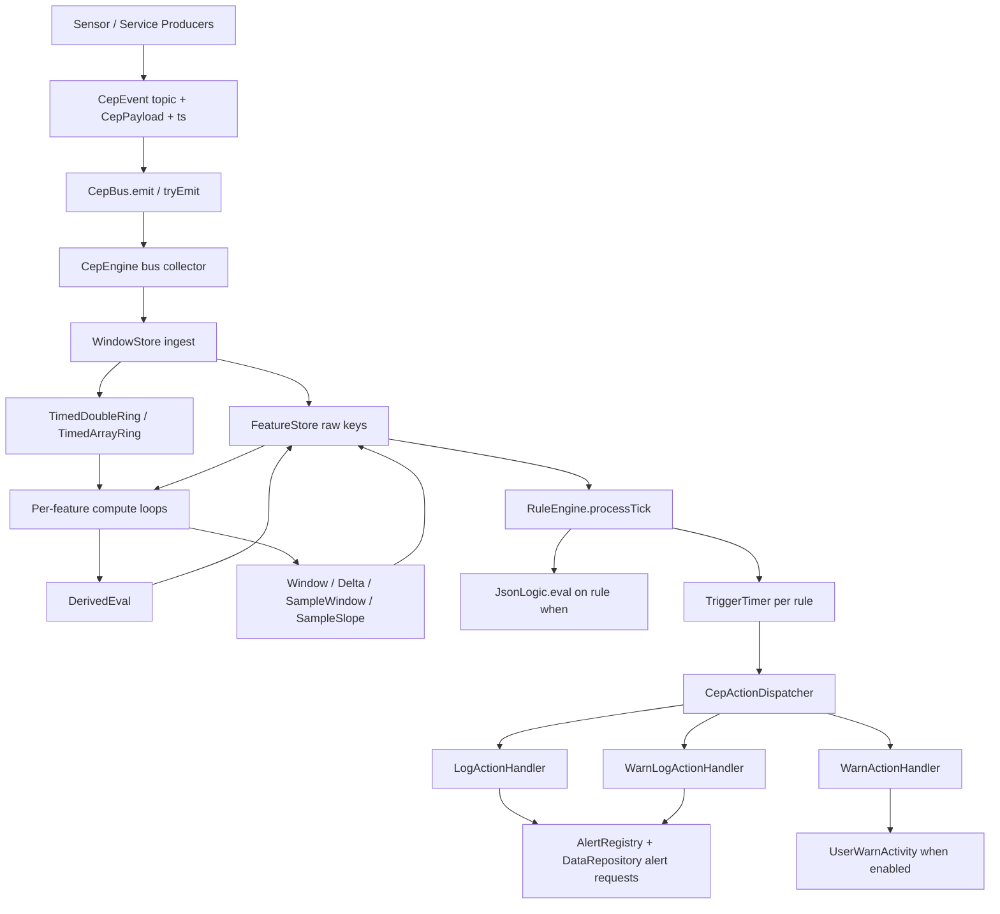
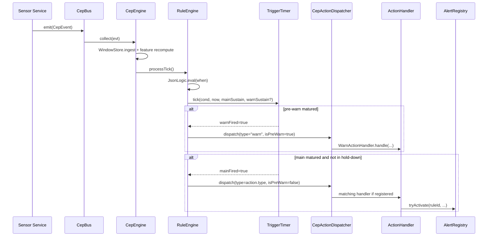

# CEP Documentation

## 1. Executive Summary

The CEP subsystem turns sensor and service outputs into alerting decisions.

At a high level it:

1. receives typed sensor/service events on `CepBus` from producers such as `HeartrateService`, `SkinTempService`, `PressureService`, `WeatherService`, `EnvSensorService`, `ActivityRecognitionService`, and `OffBodyDetectService`,
2. normalizes payload fields into raw feature keys inside `FeatureStore` and rolling rings inside `WindowStore`,
3. computes derived features declared in `app/src/main/res/raw/cep_rules.json`,
4. evaluates rule conditions from the same JSON,
5. applies sustained timers and hold-down throttling,
6. dispatches the configured action type through `CepActionDispatcher`,
7. triggers logs, user warnings, and TAK-facing alert requests when a handler is actually registered.

The live rule/config file is `app/src/main/res/raw/cep_rules.json`. Runtime parsing is implemented by `app/src/main/java/com/aitech/weartak_civ/cep/engine/RuleCompiler.kt`.

Important current-code caveats:

- `CepActionDispatcher` only registers handlers for `log`, `warn`, and `warn_log` in `app/src/main/java/com/aitech/weartak_civ/cep/di/CepProvider.kt`.
- `cep_rules.json` currently uses additional action types: `none`, `nonelog`, `nonewarn`, and `none_warn_log`.
- Under the current code, those unregistered action types do not dispatch any handler. They still mature inside `RuleEngine`, but `CepActionDispatcher` will not perform logging, warning UI, or alert registry activation for them.
- Some rule expressions refer to `features.accel_low_motion`, `features.shiver_present`, and `features.shiver_duration_s`, but those keys were not found in the CEP source tree under `app/src/main/java/com/aitech/weartak_civ/cep/`. Their producers need confirmation from the code owner.

## 2. CEP Architecture Overview



### Main runtime objects

| Component | Source | Responsibility |
| --- | --- | --- |
| `CepBus` | `app/src/main/java/com/aitech/weartak_civ/cep/bus/CepBus.kt` | Hot shared event stream used by services and the CEP engine. |
| `CepEngine` | `app/src/main/java/com/aitech/weartak_civ/cep/engine/CepEngine.kt` | Starts collectors, feature compute loops, rule loop, profile/threshold loading, and alert auto-clear checks. |
| `WindowStore` | `app/src/main/java/com/aitech/weartak_civ/cep/engine/WindowStore.kt` | Ingests payloads, writes raw feature keys, and maintains rolling timestamped rings. |
| `FeatureStore` | `app/src/main/java/com/aitech/weartak_civ/cep/engine/FeatureStore.kt` | Latest-value store plus timestamps and per-tick derived-write tracking. |
| `DerivedEval` | `app/src/main/java/com/aitech/weartak_civ/cep/engine/DerivedEval.kt` | Evaluates derived feature expressions from config. |
| `RuleEngine` | `app/src/main/java/com/aitech/weartak_civ/cep/engine/RuleEngine.kt` | Evaluates `when`, resolves sustain overrides, and dispatches actions on timer fire. |
| `TriggerTimer` | `app/src/main/java/com/aitech/weartak_civ/cep/engine/TriggerTimer.kt` | Implements wall-clock sustain, pre-warn, and hold-down. |
| `CepActionDispatcher` | `app/src/main/java/com/aitech/weartak_civ/cep/engine/action/CepActionDispatcher.kt` | Asynchronous action queue and severity-based duplicate throttling. |
| `AlertRegistry` | `app/src/main/java/com/aitech/weartak_civ/cep/engine/action/AlertRegistry.kt` | Tracks active alerts and supports later auto-clear. |

## 3. `cep_rules.json` Deep Dive

### 3.1 Location

The active rules file is:

- `app/src/main/res/raw/cep_rules.json`

An older file also exists:

- `app/src/main/res/raw/x_old_cep_rules.json`

Only `R.raw.cep_rules` is loaded by `RuleCompiler.loadFromRaw(...)`.

### 3.2 Top-level structure

| Key | Type | Meaning | Example | Runtime effect |
| --- | --- | --- | --- | --- |
| `schema_version` | string | Human/schema marker. | `"1.0"` | Not used by runtime logic. |
| `generated_at_utc` | string | Generation timestamp. | `"2026-01-20T04:43:58.293708Z"` | Informational only. |
| `notes` | string | Embedded author notes. | merged cold stress / HR notes | Informational only. |
| `merge_instructions` | array[string] | Manual merge guidance. | append features/rules | Informational only. |
| `engine` | object | Engine cadence config. | `window_tick_ms`, `rule_eval_interval_ms` | Parsed into `CepConfig.tickHz` and `ruleEvalIntervalMs`. |
| `features` | array[object] | Feature definitions. | `window`, `derived`, `sample_window` | Creates `FeatureDef` entries. |
| `rules` | array[object] | Rule definitions. | `id`, `when`, `sustained_for_sec`, `action` | Creates `RuleDef` entries. |

### 3.3 `engine` section

| Key | Type | Meaning | Runtime effect |
| --- | --- | --- | --- |
| `window_tick_ms` | int | Legacy engine tick input. | Parsed by `RuleCompiler`; converted to `tickHz`. Current feature loops do not directly use `tickHz` for window math anymore. |
| `rule_eval_interval_ms` | int | Rule evaluation cadence. | Drives the `CepEngine` rule loop delay. |

### 3.4 Supported feature definition types

Parsed in `RuleCompiler.parseFeatures(...)` and modeled in `CepConfig.kt`.

| JSON `type` | Kotlin model | Meaning |
| --- | --- | --- |
| `window` | `FeatureDef.Window` | Time-based aggregate over a numeric ring. |
| `window_multi` | `FeatureDef.MultiWindow` | Time-based aggregate over array-valued samples such as skin temperature channels. |
| `slope_multi` | `FeatureDef.SlopeMulti` | Least-squares slope over one selected channel from a multi-channel ring. |
| `delta` | `FeatureDef.Delta` | Current minus historical value by wall-clock horizon. |
| `derived` | `FeatureDef.Derived` | Derived expression evaluated by `DerivedEval`. |
| `compute` | `FeatureDef.Derived` | Alias of `derived`. |
| `threshold` | `FeatureDef.Derived` | Alias of `derived`. |
| `logic` | `FeatureDef.Derived` | Alias of `derived`. |
| `slope` | `FeatureDef.Derived` | Alias of `derived`. |
| `sample_window` | `FeatureDef.SampleWindow` | Aggregate over last N samples regardless of wall-clock span. |
| `sample_delta` | `FeatureDef.SampleDelta` | Newest sample minus sample N positions back. |
| `sample_slope` | `FeatureDef.SampleSlope` | Least-squares slope over last N samples using real timestamps. |

### 3.5 Rule field reference

Parsed in `RuleCompiler.parseRules(...)`.

| Field | Type | Meaning | Runtime effect |
| --- | --- | --- | --- |
| `id` | string | Stable rule identifier. | Used for timer ownership, alert registry ownership, sustain overrides, and logs. |
| `description` | string? | Optional descriptive text. | Parsed but not used by runtime logic. |
| `when` | object | Condition tree. | Evaluated by `JsonLogic.eval(...)`. |
| `sustained_for_sec` | long | Main sustain threshold in seconds. | Passed into `TriggerTimer.tick(...)`. |
| `sustained_for_sec_warn` | long? | Optional earlier pre-warn sustain threshold. | Only kept when `1 <= warn < sustained_for_sec`. |
| `hold_down_sec` | long | Re-fire cooldown after a main fire. | Passed into `TriggerTimer`; blocks repeated main fires until cooldown expires. |
| `action.type` | string | Handler type. | Must match a handler registered in `CepActionDispatcher`. |
| `action.severity` | string | `INFO`, `WARN`, `ALERT`, `EMERGENCY`. | Converted to `Severity`. |
| `action.message` | string | Message template. | Expanded with `{feature.key}` placeholders by handlers. |
| `action.tags` | array[string] | Tags for logging and alert metadata. | Used in log body and dispatcher dedupe key. |
| `action.category` | string? | TAK / alert category. | Passed to `DataRepository` alert request methods. |
| `action.isTak` | bool | Whether to create TAK-facing alert output. | Required for current alert registry + repo alert creation in handlers. |
| `action.isLocal` | bool | Whether rule is intended to produce local watch behavior. | `LogActionHandler` currently only comments this hook; no concrete local action beyond vibration on TAK path. |
| `action.priority_from` | string? | Priority derivation mode. | `"severity"` maps severity to TAK priority. |
| `action.priority` | int? | Explicit fallback priority. | Used when `priority_from` is not `"severity"`. |
| `action.sendSms` | bool | SMS flag. | Passed through to repository alert request methods. |
| `action.timeout` | long? | Timeout in JSON. | Parsed into `RuleAction.timeoutSec`; current handlers do not use it directly. |
| `action.monitor` | array[object] | Exit-condition list for auto-clear. | Stored in `AlertRegistry` and evaluated by `CepEngine.checkAndClearAlerts()`. |
| `action.exit_sustain_sec` | long? | Seconds exit conditions must stay satisfied before clear. | Used by `checkAndClearAlerts()`. |
| `action.exit_logic` | string? | `AND` or `OR`. | Controls how monitor conditions are combined when clearing. |
| `snapshot_keys` | array[string] | Restrict snapshot contents. | If absent/empty, handlers receive a snapshot of the whole store. |
| `allow_sustain_override` | bool | Allow DataRepository override of sustain times. | Lets `CepEngine.updateSustainOverrides()` replace main and warn sustain thresholds. |

### 3.6 Supported condition operators in rule `when`

These are the operators actually implemented in `app/src/main/java/com/aitech/weartak_civ/cep/engine/JsonLogic.kt`.

| Operator | Example | Behavior |
| --- | --- | --- |
| `and` | `{"and":[...]} ` | All children must evaluate true. |
| `or` | `{"or":[...]} ` | Any child true. |
| `not` | `{"not":{"eq_key":[...]}}` | Boolean negation of nested object. |
| `all` | `{"all":[...]} ` | Same runtime behavior as `and`. |
| `any` | `{"any":[...]} ` | Same runtime behavior as `or`. |
| `ref` + `is` | `{"ref":"features.motion.active","is":true}` | Compare store value to boolean, string, or number. |
| `eq_key` | `{"eq_key":["activity.state","STILL"]}` | Compare one feature/store key to a literal boolean/string/number. |
| `ne_key` | `{"ne_key":["activity.state","STILL"]}` | Inequality version of `eq_key`. Supported in code, not currently used in the live JSON. |
| `lte_key` | `{"lte_key":["features.spo2.delta_pct",-3]}` | Key <= literal number. Missing/non-numeric key returns `false`. |
| `gte_key` | `{"gte_key":["offbody.on_wrist",0.5]}` | Key >= literal number. Missing/non-numeric key returns `false`. |
| `lte_key_fresh` | `{"lte_key_fresh":["feature", threshold, 5]}` | Same as `lte_key` but rejects stale values using `FeatureStore.doubleIfFresh(...)`. |
| `gte_key_fresh` | `{"gte_key_fresh":["feature", threshold, 5]}` | Same as `gte_key` but freshness-aware. |
| `gte_keys` | `{"gte_keys":["features.heart_rate","features.hr.high_threshold_bpm"]}` | Compare two numeric keys. Missing either side returns `false`. |
| `lte_keys` | `{"lte_keys":["features.heart_rate","thresholds.hr.rest_low_bpm"]}` | Compare two numeric keys. Missing either side returns `false`. |
| `lt_key` | `{"lt_key":["features.heart_rate",40]}` | Key < literal number. |
| `gt_key` | `{"gt_key":["features.hrr_percent",100]}` | Key > literal number. Supported in code, not used by live rules. |
| `between` | `{"between":["features.hrr_percent",50,60]}` | Inclusive numeric range. |
| `zscore_lt` | `{"zscore_lt":["seriesKey", window, thr]}` | Uses `SeriesRepo`; supported in code, not used by live rules. |
| `zscore_gt` | `{"zscore_gt":["seriesKey", window, thr]}` | Uses `SeriesRepo`; supported in code, not used by live rules. |
| `recently_in` | `{"recently_in":["state.key", sec]}` | Uses `StateTracker`; supported in code, not used by live rules. |

#### Missing/null handling

- Numeric rule operators are intentionally fail-closed.
- `lte_key`, `gte_key`, `lt_key`, `gt_key`, `gte_keys`, and `lte_keys` return `false` if required keys are missing or non-numeric.
- `lte_key_fresh` and `gte_key_fresh` also return `false` if the key is older than the provided `maxAgeSec`.
- `eq_key` and `ref/is` compare by requested type; if the stored type is incompatible, they resolve `false`.

### 3.7 Supported derived-expression operators

Derived feature `expr` objects are evaluated by `DerivedEval`, not by `JsonLogic` first.

Supported numeric/boolean constructs found in `DerivedEval.kt`:

- specialized functions: `wind_chill`, `zone_min_bpm`, `mark_state`, `karvonen_ratio`, `categorical`
- numeric ops: `key`, `div`, `mul`, `sub`, `add`, `max`, `min`, `sum`, `case`
- boolean ops: `lte`, `gte`, `lt`, `gt`, `eq`, `and`, `or`, `not`, `ref/is`
- fallback: if a derived expression is not handled by the above, `DerivedEval` falls back to `JsonLogic.eval(...)`

### 3.8 Live rule inventory

Expected alert behavior below reflects current code, not intended semantics.

| Rule ID | Purpose | Feature keys used | Condition summary | Sustained time | Action | Severity | Expected alert behavior |
| --- | --- | --- | --- | --- | --- | --- | --- |
| `cold_override_wind_chill_frostbite` | Frostbite override on severe wind chill | `features.wind_chill.emergency_override`, `features.wind_chill.c` | true when emergency wind chill override is true | 10s | `nonelog` | EMERGENCY | No action handler registered for `nonelog`; no current dispatch. |
| `cold_override_tactile_failure` | Cold emergency override on tactile failure | `features.hand.tactile_failure` | true when tactile failure feature is true | 20s | `nonelog` | EMERGENCY | No current dispatch. |
| `cold_override_skin_temp_20c` | Cold emergency override on skin <= 20 C | `features.skin_temp.severe_vasoconstriction` | true when severe vasoconstriction feature is true | 60s | `nonelog` | EMERGENCY | No current dispatch. |
| `cold_alert_dexterity_loss` | Cold alert on dexterity loss | `features.hand.dexterity_loss` | true when hand dexterity loss feature is true | 60s | `nonelog` | ALERT | No current dispatch. |
| `immersion_suspected_alert` | Cold/immersion corroborator | `features.immersion.suspected` | true when rapid cooling and PPG collapse align | 10s | `nonelog` | ALERT | No current dispatch. |
| `cold_state_warn` | Cold state warn tier | `features.cold.risk_state`, `features.cold.score` | risk state equals `WARN` | 60s | `nonelog` | WARN | No current dispatch. |
| `cold_state_alert` | Cold state alert tier | `features.cold.risk_state`, `features.cold.score` | risk state equals `ALERT` | 60s | `nonelog` | ALERT | No current dispatch. |
| `cold_state_emergency` | Cold state emergency tier | `features.cold.risk_state`, `features.cold.score` | risk state equals `EMERGENCY` | 30s | `nonelog` | EMERGENCY | No current dispatch. |
| `hr_above_hrmax_recalib_candidate` | Detect sustained HR above HRmax with low HRV | `features.motion.active`, `features.hr.above_hrmax`, `features.hrv.rmssd_recent_1m` | all three true | 60s | `nonelog` | ALERT | No current dispatch. |
| `hr_high_threshold_resting_alert` | High resting HR alert | `activity.state`, `offbody.on_wrist`, `features.heart_rate`, `features.hr.high_threshold_bpm` | still + on-wrist + fresh HR above threshold | 600s | `log` | EMERGENCY | Registered; logs, activates `AlertRegistry`, vibrates, and writes TAK-facing repo alert. |
| `hr_high_threshold_resting_warning` | High resting HR warning | `activity.state`, `offbody.on_wrist`, `features.heart_rate`, `features.hr.high_threshold_bpm` | still + on-wrist + HR above threshold | 300s | `log` | WARN | Registered; same `log` handler path as above. |
| `hr_hrmax_exercise_60s_emergency` | Exercise >HRmax emergency | `activity.state`, `sleep.is_sleeping`, `features.hrr_percent` | not still + awake + %HRR >= 100 | 10s | `nonelog` | EMERGENCY | No current dispatch. `action.monitor` exists but cannot matter unless alert activates. |
| `hr_hrmax_rest_immediate_emergency` | Resting >HRmax emergency with pre-warn | `activity.state`, `sleep.is_sleeping`, `features.hrr_percent` | still + awake + %HRR >= 100 | warn 120s, main 180s | `nonelog` | EMERGENCY | Pre-warn dispatches as handler type `warn` and can show warning UI if `isTak=true`; main `nonelog` fire has no handler. |
| `hr_low_threshold_3s_alert` | Low HR threshold alert | `features.hr.low_threshold_bpm`, `features.heart_rate` | low threshold >= heart rate | 300s | `none` | ALERT | No current dispatch. |
| `hr_low_threshold_resting_alert` | Low resting HR alert | `activity.state`, `sleep.is_sleeping`, `features.hr.low_threshold_bpm`, `features.heart_rate`, `offbody.on_wrist` | still + awake + on-wrist + HR <= low threshold | 600s | `log` | EMERGENCY | Registered `log` path; includes auto-clear monitor. |
| `hr_low_threshold_resting_warning` | Low resting HR warning | same as above | same as above | 300s | `log` | WARN | Registered `log` path; includes auto-clear monitor. |
| `hr_low_threshold_resting_alert_static` | Static low resting HR alert with pre-warn | `activity.state`, `sleep.is_sleeping`, `features.heart_rate`, `thresholds.hr.rest_low_bpm`, `offbody.on_wrist` | still + awake + on-wrist + HR <= static threshold | warn 300s, main 600s | `none_warn_log` | EMERGENCY | Pre-warn uses `warn` handler. Main fire has no `none_warn_log` handler. |
| `hr_rest_brady_10min_emergency_static` | Static bradycardia emergency | `activity.state`, `sleep.is_sleeping`, `features.heart_rate`, `offbody.on_wrist` | still + awake + HR < 40 + on-wrist | warn 300s, main 600s | `none` | EMERGENCY | Pre-warn uses `warn` handler. Main `none` fire has no handler. |
| `hr_zone1_rest_10min_alert` | Zone 1 at rest | `activity.state`, `sleep.is_sleeping`, `features.hrr_percent` | still + awake + 50..60% HRR | 10s | `none` | ALERT | No current dispatch. |
| `hr_zone2_rest_60s_alert` | Zone 2 at rest | `activity.state`, `sleep.is_sleeping`, `features.hrr_percent` | still + awake + 60..70% HRR | 10s | `none` | ALERT | No current dispatch. |
| `hr_zone3_exercise_30s_warn` | Zone 3 during exercise | `activity.state`, `sleep.is_sleeping`, `features.hrr_percent` | not still + awake + 70..80% HRR | 10s | `none` | EMERGENCY | No current dispatch. |
| `hr_zone3_rest_30s_alert` | Zone 3 at rest | `activity.state`, `sleep.is_sleeping`, `features.hrr_percent` | still + awake + 70..80% HRR | 10s | `none` | EMERGENCY | No current dispatch. |
| `exertion_warning_hr_zone4_exercise` | Exertion warning threshold rule | `activity.state`, `sleep.is_sleeping`, `offbody.on_wrist`, `features.hrr_percent`, `features.hr.exertion_warning_threshold_hrr_percent` | not still + awake + on-wrist + HRR >= warning threshold | 120s | `log` | WARN | Registered `log` path; includes auto-clear monitor. |
| `hr_zone4_exercise_10min_emergency` | Zone 4 exercise emergency | `activity.state`, `sleep.is_sleeping`, `features.hr.exertion_warning_active`, `features.hrr_percent`, `features.hr.exertion_warning_threshold_hrr_percent` | not still + awake + exertion-warning-active | 180s | `nonewarn` | EMERGENCY | No current main dispatch. |
| `hr_zone4_rest_immediate_emergency` | Zone 4 at rest | `activity.state`, `sleep.is_sleeping`, `features.hrr_percent` | still + awake + 80..90% HRR | 5s | `nonelog` | EMERGENCY | No current dispatch. |
| `exertion_alert_hr_zone5_exercise` | Exertion alert threshold rule | `activity.state`, `sleep.is_sleeping`, `offbody.on_wrist`, `features.hrr_percent`, `features.hr.exertion_alert_threshold_hrr_percent` | not still + awake + on-wrist + HRR >= alert threshold | 120s | `log` | EMERGENCY | Registered `log` path; includes auto-clear monitor. |
| `hr_zone5_exercise_5min_emergency` | Zone 5 exercise emergency | `activity.state`, `sleep.is_sleeping`, `features.hrr_percent`, `features.hr.exertion_alert_threshold_hrr_percent` | not still + awake + HRR >= alert threshold | 180s | `nonelog` | EMERGENCY | No current dispatch. |
| `hr_zone5_rest_immediate_emergency` | Zone 5 at rest | `activity.state`, `sleep.is_sleeping`, `features.hrr_percent` | still + awake + 90..100% HRR | 10s | `none` | EMERGENCY | No current dispatch. |
| `hrv_drop_alert` | Resting HRV drop corroborator | `features.hrv.rmssd_drop_ratio`, `features.accel_low_motion` | HRV drop >= 0.2 and low motion | 120s | `nonelog` | ALERT | No current dispatch; also depends on unresolved `features.accel_low_motion`. |
| `ppg_collapse_alert` | PPG perfusion-loss corroborator | `features.ppg.collapse_gt50pct` | collapse feature true | 20s | `nonelog` | ALERT | No current dispatch. |
| `spo2_drop_alert` | SpO2 drop corroborator | `features.spo2.delta_pct` | delta <= -3 | 60s | `nonelog` | ALERT | No current dispatch. |
| `pressure_dunk_detected` | Rapid immersion warning | `settings.pressure.immersion_alerts_enabled`, `features.pressure.delta_rapid_rise`, `offbody.on_wrist` | pressure rise + feature enabled + on-wrist | warn 5s, main 2s | `log` | WARN | Main registered `log` path; pre-warn uses `warn` handler. |
| `pressure_shallow_dunk` | Shallow immersion warning | `settings.pressure.immersion_alerts_enabled`, `features.pressure.delta_shallow_rise`, `offbody.on_wrist` | moderate pressure rise + feature enabled + on-wrist | warn 3s, main 1s | `log` | WARN | Main registered `log` path; pre-warn uses `warn` handler. |
| `pressure_submerge_detected` | Sustained immersion alert | `settings.pressure.immersion_alerts_enabled`, `features.pressure.submerge_rise`, `offbody.on_wrist` | elevated pressure above rolling baseline + enabled + on-wrist | warn 30s, main 5s | `log` | ALERT | Main registered `log` path; pre-warn uses `warn` handler. |
| `pressure_low_atm` | Low atmospheric pressure alert | `settings.pressure.low_atm_alert_enabled`, `features.pressure.below_low_threshold` | low pressure feature true + feature enabled | warn 60s, main 5s | `log` | EMERGENCY | Main registered `log` path; pre-warn uses `warn` handler. |
| `pressure_high_atm` | High atmospheric pressure alert | `settings.pressure.high_atm_alert_enabled`, `features.pressure.above_high_threshold` | high pressure feature true + feature enabled | warn 60s, main 5s | `log` | EMERGENCY | Main registered `log` path; pre-warn uses `warn` handler. |

### 3.9 Current action type inventory

Action types present in the live JSON:

- `log`
- `none`
- `none_warn_log`
- `nonelog`
- `nonewarn`

Action types registered in `CepProvider.getActionDispatcher()`:

- `log`
- `warn`
- `warn_log`

This mismatch is operationally important. A rule can mature and still produce no external effect if its `action.type` does not correspond to a registered handler.

## 4. Feature Key Dictionary

This section covers keys written by `WindowStore`, `CepEngine`, or derived feature computation, plus rule-referenced keys.

### 4.1 Direct/raw keys written into `FeatureStore`

| Feature Key | Source payload/service | Type | Units | Meaning | Used By Rules |
| --- | --- | --- | --- | --- | --- |
| `heart_rate` and resolved as `features.heart_rate` | `HeartRatePayload` from `HeartrateService` | double | bpm | Latest heart rate. | Most HR rules, cold score. |
| `ambient.temp_c` | `AmbientPayload`, weather direct ingest | double | C | Ambient air temperature. | `features.wind_chill.c`. |
| `ambient.wind_mps` | `AmbientPayload` or `WindPayload` | double | m/s | Ambient wind speed. | `features.wind_chill.c`. |
| `ambient.humidity_pct` | `AmbientPayload` | double? | % | Ambient humidity from combined ambient payload. | No direct live rule use. |
| `accel.magnitude_g` | `AccelPayload` | double | g | Motion magnitude. | Not directly used by live rules in current CEP package. |
| `accel.cadence_spm` | `AccelPayload` | double? | spm | Cadence if provided. | No direct live rule use. |
| `activity.state` | `ActivityPayload` from `ActivityRecognitionService` / simulation | string | enum-like | Activity state such as `STILL`, `RUN`, `WALKING`, `UNKNOWN`. | Most HR posture/activity gating rules. |
| `spo2` | `Spo2Payload` from `SkinTempService` | double | % | Latest oxygen saturation. | `features.spo2.*` windows and derived delta. |
| `hrv.rmssd_ms` | `HrvPayload` from `SkinTempService` / simulation | double | ms | RMSSD HRV signal. | `features.hrv.*`, `hr_above_hrmax_recalib_candidate`. |
| `immersion.wet_flag` | `ImmersionPayload` | bool | flag | Wetness indication. | No direct live rule use. |
| `immersion.immersion_flag` | `ImmersionPayload` | bool | flag | Immersion indication. | No direct live rule use. |
| `sleep.is_sleeping` | `SleepPayload` from `ActivityRecognitionService` / simulation | bool | flag | Sleep state. | Many HR rules gate on awake state. |
| `offbody.on_wrist` | `OffBodyPayload` from `OffBodyDetectService` / simulation | int/double-coercible | 0 or 1 | On-wrist/off-body gate. | Many HR and pressure rules. |
| `wind.direction_deg` | `WindPayload` | float/double-coercible | degrees | Wind direction. | No direct live rule use. |
| `gyro.x_dps` | `GyroPayload` | double | deg/s | Gyro X component. | No direct live rule use. |
| `gyro.y_dps` | `GyroPayload` | double | deg/s | Gyro Y component. | No direct live rule use. |
| `gyro.z_dps` | `GyroPayload` | double | deg/s | Gyro Z component. | No direct live rule use. |
| `gyro.rms_dps` | `GyroPayload` | float/double-coercible | deg/s | Gyro RMS. | No direct live rule use. |
| `ppg.amplitude` | `PpgPayload` from `SkinTempService` | float/double-coercible | device-specific | Perfusion amplitude. | `features.ppg.*`, immersion/cold corroborators. |
| `ppg.quality` | `PpgPayload` | float | 0..1 | PPG signal quality. | No direct live rule use. |
| `ppg.wavelength` | `PpgPayload` | string | label | PPG LED wavelength. | No direct live rule use. |
| `humidity.relative_percent` | `HumidityPayload` or `AmbientPayload` companion service | float/double-coercible | % | Relative humidity. | `features.env.wet_flag`. |
| `water_sensor.wet` | `WaterPayload` or weather wet derivation | bool | flag | Wet contact / wetness. | `features.env.wet_flag`. |
| `ambient.water_temp_c` | `WaterPayload` | float/double-coercible | C | Water temperature if present. | No direct live rule use. |
| `light.lux` | `LightPayload` | float/double-coercible | lux | Ambient light level. | `features.coverage.exposed`. |
| `als.covered` | `LightPayload` | bool | flag | ALS-covered heuristic. | `features.coverage.exposed`. |
| `pressure` and resolved as `features.pressure` if requested | `PressurePayload` from `PressureService` | double | hPa | Latest pressure reading. | pressure sample features. |
| `pressure.accuracy` | `PressurePayload` | double | sensor status | Pressure sensor accuracy code. | No direct live rule use. |

### 4.2 Profile, settings, and threshold keys

| Feature Key | Source | Type | Units | Meaning | Used By Rules |
| --- | --- | --- | --- | --- | --- |
| `profile.hr_rest_bpm` | `CepEngine.updateHrProfile()` | double | bpm | Resting HR baseline from repo/default. | `features.hr.hrr`, `%HRR`, HRmax logic. |
| `profile.hr_max_bpm` | `CepEngine.updateHrProfile()` using `ZoneHelper.tanakaHrMax(age)` | double | bpm | Estimated HR max. | `features.hr.above_hrmax`, `%HRR`, cold score. |
| `thresholds.hr.rest_high_bpm` | `CepEngine.updateHrProfile()` | double | bpm | Resting high-HR threshold. | `features.hr.high_threshold_bpm`. |
| `thresholds.hr.rest_low_bpm` | `CepEngine.updateHrProfile()` | double | bpm | Resting low-HR threshold. | low-HR rules. |
| `thresholds.hrr.exert_warn_percent` | `CepEngine.updateHrrProfile()` | double | %HRR | Exertion warning threshold. | exertion warning features/rules. |
| `thresholds.hrr.exert_alert_percent` | `CepEngine.updateHrrProfile()` | double | %HRR | Exertion alert threshold. | exertion alert features/rules. |
| `thresholds.pressure.high` | `CepEngine.updatePressureProfile()` | double | hPa | High atmospheric pressure threshold. | pressure high feature/rule. |
| `thresholds.pressure.low` | `CepEngine.updatePressureProfile()` | double | hPa | Low atmospheric pressure threshold. | pressure low feature/rule. |
| `settings.pressure.immersion_alerts_enabled` | `CepEngine.updatePressureProfile()` | double | 0 or 1 | User enable gate for immersion rules. | pressure immersion rules. |
| `settings.pressure.low_atm_alert_enabled` | `CepEngine.updatePressureProfile()` | double | 0 or 1 | User enable gate for low pressure rules. | `pressure_low_atm`. |
| `settings.pressure.high_atm_alert_enabled` | `CepEngine.updatePressureProfile()` | double | 0 or 1 | User enable gate for high pressure rules. | `pressure_high_atm`. |

### 4.3 Derived and computed keys declared in config

| Feature Key | Source / derivation | Type | Units | Meaning | Used By Rules |
| --- | --- | --- | --- | --- | --- |
| `features.skin_temp.hand_min_c_1m` | `window_multi` over `skin_temp` min/min for 60s | double | C | Minimum hand/peripheral skin temp over 1 minute. | cold overrides, dexterity, cold score. |
| `features.skin_temp.severe_vasoconstriction` | `hand_min_c_1m <= 20` | bool | bool | Severe peripheral vasoconstriction indicator. | `cold_override_skin_temp_20c`. |
| `features.device.off_body` | `offbody.on_wrist >= 0.5` | bool | bool | Off-body flag inverse-ish helper. | Not used by live rules. |
| `features.skin_temp.slope_c_per_s_20s` | `slope_multi` on `skin_temp` | double | C/s | Cooling/warming slope over 20s. | immersion suspicion logic. |
| `features.hand.dexterity_loss` | `hand_min_c_1m <= 15` | bool | bool | Dexterity impairment indicator. | `cold_alert_dexterity_loss`. |
| `features.hand.tactile_failure` | `hand_min_c_1m <= 8` | bool | bool | Severe hand tactile loss indicator. | `cold_override_tactile_failure`. |
| `features.wind_chill.c` | `wind_chill(temp, wind)` | double | C | Calculated wind chill. | cold override and cold score. |
| `features.wind_chill.emergency_override` | `wind_chill.c <= -27` | bool | bool | Frostbite emergency override. | `cold_override_wind_chill_frostbite`. |
| `features.immersion.suspected` | cooling slope + PPG collapse | bool | bool | Heuristic immersion suspicion. | `immersion_suspected_alert`. |
| `features.ppg.amplitude_baseline_600s` | 600s average on `ppg.amplitude` | double | device-specific | Long PPG baseline. | `features.ppg.amplitude_ratio`. |
| `features.ppg.amplitude_recent_20s` | 20s average on `ppg.amplitude` | double | device-specific | Recent PPG average. | `features.ppg.amplitude_ratio`. |
| `features.ppg.amplitude_ratio` | recent / max(baseline, 1e-6) | double | ratio | Relative perfusion amplitude. | collapse rule features. |
| `features.ppg.collapse_gt50pct` | `amplitude_ratio <= 0.5` | bool | bool | Perfusion collapse indicator. | immersion, cold score, `ppg_collapse_alert`. |
| `features.spo2.baseline_86400s` | 24h average on `spo2` | double | % | Long SpO2 baseline. | `features.spo2.delta_pct`. |
| `features.spo2.recent_120s` | 120s average on `spo2` | double | % | Recent SpO2 baseline. | `features.spo2.delta_pct`. |
| `features.spo2.delta_pct` | normalized delta between recent and baseline | double | % | Relative SpO2 drop. | cold score, `spo2_drop_alert`. |
| `features.hrv.rmssd_baseline_24h` | 24h average on `hrv.rmssd_ms` | double | ms | Long HRV baseline. | `features.hrv.rmssd_drop_ratio`. |
| `features.hrv.rmssd_recent_1m` | 60s average on `hrv.rmssd_ms` | double | ms | Recent HRV. | `hr_above_hrmax_recalib_candidate`. |
| `features.hrv.rmssd_drop_ratio` | `(baseline - recent) / max(1, baseline)` | double | ratio | HRV suppression ratio. | cold score, `hrv_drop_alert`. |
| `features.env.wet_flag` | `water_sensor.wet || humidity.relative_percent >= 95` | bool | bool | Wetness corroborator. | Not used by live rules. |
| `features.cold.score` | additive score using temp, shiver, HR, HRV, SpO2, wind chill | double | points | Multi-signal cold stress score. | `features.cold.risk_state`. |
| `features.cold.risk_state` | categorical bins over cold score | string | enum | `NORMAL`, `WARN`, `ALERT`, `EMERGENCY`. | cold state rules. |
| `features.hr.above_hrmax` | `heart_rate > profile.hr_max_bpm` | bool | bool | Sustained above-HRmax signal. | `hr_above_hrmax_recalib_candidate`. |
| `features.hr.delta_60s` | 60s delta on `heart_rate` | double | bpm | HR change over 60s. | `features.hr.slope_bpm_per_min_60s`, cold score. |
| `features.hr.high_threshold_bpm` | passthrough from `thresholds.hr.rest_high_bpm` | double | bpm | High resting threshold helper. | high resting HR rules. |
| `features.hr.low_threshold_bpm` | passthrough from `thresholds.hr.rest_low_bpm` | double | bpm | Low resting threshold helper. | low resting HR rules. |
| `features.hr.hrr` | `(HR - HRrest) / max(1, HRmax - HRrest)` | double | ratio | Heart-rate reserve fraction. | `%HRR`, cold score. |
| `features.hr.max_baseline_bpm` | passthrough from `profile.hr_max_bpm` | double | bpm | Max baseline helper. | Not directly used by live rules. |
| `features.hr.rest_baseline_bpm` | passthrough from `profile.hr_rest_bpm` | double | bpm | Rest baseline helper. | Not directly used by live rules. |
| `features.hr.slope_bpm_per_min_60s` | `1.0 * features.hr.delta_60s` | double | bpm/min | Named HR slope helper. | cold score. |
| `features.hrr_percent` | `features.hr.hrr * 100` | double | %HRR | Primary HR exertion metric. | many HR rules. |
| `features.coverage.exposed` | `als.covered == false || light.lux >= 5` | bool | bool | Exposure heuristic. | Not used by live rules. |
| `features.motion.active` | `not features.accel_low_motion` | bool | bool | Motion helper. | `hr_above_hrmax_recalib_candidate`. Depends on unresolved source key. |
| `features.hr.exertion_warning_threshold_hrr_percent` | passthrough from `thresholds.hrr.exert_warn_percent` | double | %HRR | Warning threshold helper. | exertion warning rules. |
| `features.hr.exertion_alert_threshold_hrr_percent` | passthrough from `thresholds.hrr.exert_alert_percent` | double | %HRR | Alert threshold helper. | exertion alert rules. |
| `features.hr.exertion_warning_active` | hrr between warning and alert threshold | bool | bool | Zone-4 active helper. | `hr_zone4_exercise_10min_emergency`. |
| `features.pressure.mean_n5` | `sample_window avg` over last 5 pressure samples | double | hPa | Short pressure average. | pressure threshold and submerge features. |
| `features.pressure.delta_n5` | newest pressure minus 5-samples-back pressure | double | hPa | Rapid pressure change. | rapid/shallow rise features. |
| `features.pressure.slope_n20` | LSQ slope over last 20 pressure samples | double | hPa/s | Pressure slope helper. | Not directly used by live rules. |
| `features.pressure.delta_rapid_rise` | `delta_n5 > 5` | bool | bool | Strong rapid rise. | `pressure_dunk_detected`. |
| `features.pressure.delta_shallow_rise` | `2 <= delta_n5 <= 4` | bool | bool | Moderate rise. | `pressure_shallow_dunk`. |
| `features.pressure.above_high_threshold` | `mean_n5 > thresholds.pressure.high` | bool | bool | High pressure state. | `pressure_high_atm`. |
| `features.pressure.below_low_threshold` | `mean_n5 < thresholds.pressure.low` | bool | bool | Low pressure state. | `pressure_low_atm`. |
| `features.pressure.mean_n20` | `sample_window avg` over last 20 pressure samples | double | hPa | Baseline pressure average. | `features.pressure.submerge_rise`. |
| `features.pressure.submerge_rise` | `mean_n5 - mean_n20` | double | hPa | Sustained rise above rolling baseline. | `pressure_submerge_detected`. |

### 4.4 Referenced but unresolved keys

These keys are referenced by config but were not found as CEP-produced keys under `app/src/main/java/com/aitech/weartak_civ/cep/`:

| Key | Where referenced | Status |
| --- | --- | --- |
| `features.accel_low_motion` | `features.motion.active`, `hrv_drop_alert` | Needs confirmation from code owner. |
| `features.shiver_present` | `features.cold.score` | Needs confirmation from code owner. |
| `features.shiver_duration_s` | `features.cold.score` | Needs confirmation from code owner. |

## 5. CEP Package Walkthrough

### 5.1 `bus/`

#### `CepBus.kt`

Source: `app/src/main/java/com/aitech/weartak_civ/cep/bus/CepBus.kt`

- Exposes `events`, a `MutableSharedFlow<CepEvent<out CepPayload>>`.
- Buffer config:
  - `replay = 0`
  - `extraBufferCapacity = 1024`
  - `onBufferOverflow = BufferOverflow.DROP_OLDEST`
- `emit(event)` is suspend and backpressure-aware.
- `tryEmit(event)` is non-suspending and returns `false` when the buffer cannot accept the event.
- Threading: producers may call from any coroutine; `SharedFlow` is thread-safe.
- Backpressure behavior: once the shared-flow buffer is full, oldest buffered events are dropped. CEP does not currently surface a dropped-event metric.
- Safe producer pattern exists in `PressureService`: use `tryEmit(...)` first, then fall back to launching `emit(...)`.

### 5.2 `di/`

#### `CepProvider.kt`

Source: `app/src/main/java/com/aitech/weartak_civ/cep/di/CepProvider.kt`

- Holds process-global singletons for:
  - `CepEngine`
  - `CepActionDispatcher`
  - `ProfileStore`
- Uses a shared `CoroutineScope(SupervisorJob() + Dispatchers.Default)`.
- `getOrCreateEngine(context)`:
  - loads config through `RuleCompiler.loadFromRaw(context)`,
  - obtains `DataRepository` from `WearTakApplication`,
  - loads year of birth synchronously with `runBlocking`,
  - constructs `CepEngine`.
- `getActionDispatcher()` currently registers only:
  - `LogActionHandler`
  - `WarnActionHandler`
  - `WarnLogActionHandler`
- Common extension point: add new `ActionHandler` registration here when introducing a new `action.type`.
- Failure mode: forgetting to register a handler leaves rules inert at dispatch time.

### 5.3 `engine/`

#### `CepConfig.kt`

- Defines `CepConfig`, `FeatureDef`, `RuleDef`, `RuleAction`, and `ExitCondition`.
- Owns the runtime schema contract between JSON and engine code.
- Important fields:
  - `FeatureDef.updateIntervalMs`
  - `RuleDef.sustainedForSec`
  - `RuleDef.sustainedForSecWarn`
  - `RuleDef.holdDownSec`
  - `RuleAction.monitor`
- Extension point: add new feature kinds or new action metadata here first, then parse them in `RuleCompiler`.
- Failure mode: adding JSON fields without updating parser/model produces silent drops.

#### `CepEngine.kt`

- Main orchestrator.
- Responsibilities:
  - loads thresholds/profile values into `FeatureStore`,
  - subscribes to `CepBus.events`,
  - starts one compute coroutine per feature definition,
  - starts the rule loop,
  - applies sustain overrides from `DataRepository`,
  - clears active alerts when exit conditions are satisfied.
- Important functions:
  - `start()`
  - `updateHrProfile()`
  - `updateHrrProfile()`
  - `updatePressureProfile()`
  - `updateSustainOverrides()`
  - `checkAndClearAlerts()`
  - `ingest(path, value, tsMs)` for generic numeric injection
- State owned:
  - `FeatureStore`
  - `WindowStore`
  - sustain override maps
  - `RuleEngine`
- Failure modes:
  - bad config feature can fail its own loop, but the exception is isolated,
  - stale or missing profile thresholds suppress downstream rules,
  - alert auto-clear only applies to alerts that were actually registered in `AlertRegistry`.
- Extension point: this is where you wire new threshold/profile loaders and any new rule-eval side loops.

#### `DerivedEval.kt`

- Evaluates `FeatureDef.Derived`.
- Specialized handlers:
  - `wind_chill`
  - `zone_min_bpm`
  - `mark_state`
  - `karvonen_ratio`
  - `categorical`
- Generic numeric support:
  - `div`, `mul`, `sub`, `add`, `max`, `min`, `sum`, `case`, `key`
- Generic boolean support:
  - `lte`, `gte`, `lt`, `gt`, `eq`, `and`, `or`, `not`, `ref/is`
- Writes results with `FeatureStore.putDerived(...)`.
- Failure mode: any missing numeric dependency usually causes the derived feature write to be skipped, which then causes downstream rules to read `null` and fail closed.
- Extension point: add new expression operators here first if they are derived-feature operators rather than rule `when` operators.

#### `FeatureStore.kt`

- Stores latest key/value pairs and timestamps.
- Key behaviors:
  - auto-prefixes non-dotted names with `features.`
  - rejects `null` writes
  - rejects `NaN` for raw and derived writes
  - tracks last-write timestamp per key
  - supports freshness-aware reads with `doubleIfFresh(...)`
- Important functions:
  - `put(...)`
  - `putAll(...)`
  - `putDerived(...)`
  - `double(...)`, `bool(...)`, `str(...)`, `any(...)`
  - `ageSeconds(...)`
  - `snapshot(...)`
  - `clear(...)`
- State owned:
  - concurrent value map
  - concurrent timestamp map
  - per-tick list of derived writes for logging
- Failure mode: writing inconsistent key names creates hard-to-debug null reads because rules/derived features are string-keyed.

#### `JsonLogic.kt`

- Evaluates rule `when` objects.
- This implementation is intentionally narrow, not a general JSON Logic interpreter.
- Also defines:
  - `SeriesRepo` for z-score history
  - `StateRepo` wrapping `StateTracker`
- Failure mode: unsupported operators silently resolve to `false`.
- Extension point: add new rule operators here and document null semantics explicitly.

#### `ProfileStore.kt`

- Lightweight shared-preference profile helper.
- Exposes:
  - `hrRestBpm()`
  - `hrMaxBpm(ageYears)`
  - `updateRestCandidate(value)`
  - `updateObservedMax(value)`
- Current CEP engine mostly uses `DataRepository` instead of this object directly for thresholds/profile loading.
- Needs confirmation from code owner whether this remains a future-facing helper or legacy support.

#### `RingConfig.kt`

- Configures ring capacities.
- Defaults:
  - numeric history: 3600 seconds
  - array history: 3600 seconds
  - max sensor rate: 4 Hz
- Key design point: ring capacity is based on max sensor rate, not CEP tick rate.
- Extension point: increase `maxSensorHz` if a new producer emits faster than 4 Hz.

#### `RuleCompiler.kt`

- Parses raw JSON into `CepConfig`.
- Responsibilities:
  - load `R.raw.cep_rules`
  - parse engine cadence
  - parse features
  - parse rules, including `monitor`, `exit_sustain_sec`, and sustain warn validation
- Failure mode: parser exceptions are caught and logged, and the engine falls back to empty feature/rule lists instead of crashing.
- Extension point: update this file whenever the JSON schema changes.

#### `RuleEngine.kt`

- Evaluates every rule on every rule tick.
- Flow:
  1. compute `cond = JsonLogic.eval(r.condition, fs)`
  2. apply sustain overrides if `allowSustainOverride`
  3. tick that rule’s `TriggerTimer`
  4. snapshot requested keys
  5. dispatch pre-warn as handler type `warn`
  6. dispatch main fire as configured `action.type`
- Important behavior:
  - each rule gets its own `TriggerTimer`,
  - `sustained_for_sec_warn` only survives if it is smaller than the main sustain,
  - pre-warn always dispatches with `action.copy(type = "warn")`.
- Failure mode: a rule can mature successfully but do nothing if `action.type` is not registered.

#### `StateTracker.kt`

- Simple temporal state marker.
- Functions:
  - `mark(key, isTrue, now)`
  - `recentlyIn(key, seconds, now)`
- Used through `StateRepo` in `JsonLogic`.
- Current live rules do not use `recently_in`, but the support exists.

#### `TriggerTimer.kt`

- Implements rule sustain and cooldown.
- State:
  - `conditionTrueStartMs`
  - `lastFireAt`
  - `warnFiredThisEpisode`
- Behavior:
  - sustain is wall-clock based, not tick-count based,
  - warn can fire once per true episode,
  - main fire can repeat after `holdDownSec` if the condition remains mature.
- Failure mode: incorrect `hold_down_sec` or mismatched time expectations cause “fires too often” or “never refires” issues.

#### `WindowStore.kt`

- Ingests payloads into raw feature keys and rolling rings.
- Maintains:
  - `TimedDoubleRing` map for scalar streams
  - `TimedArrayRing` map for multi-channel streams
- Computes:
  - time windows
  - multi-channel windows
  - time-based deltas
  - time-based slopes
  - sample-count windows/deltas/slopes
- Important behavior:
  - uses event timestamps from `CepEvent.ts`,
  - suppresses writes when windows are empty or stale,
  - pressure sample features are generic and not hard-coded to `PressureService`.
- Failure mode: if a payload never populates the correct ring key, derived window features stay null forever.

#### `ZoneHelper.kt`

- HR helper math:
  - `tanakaHrMax(age)`
  - `hrr(hrRest, hrMax)`
  - `karvonenMinBpm(...)`
  - `percentHrr(...)`
  - `bpmToPercentHrr(...)`
- Used indirectly by profile loading and some derived feature formulas.

### 5.4 `engine/action/`

#### `ActionHandler.kt`

- Interface:
  - `val type: String`
  - `suspend fun handle(ctx: TriggerContext)`

#### `ActionModels.kt`

- Defines:
  - `Severity`
  - `ActionDef`
  - `TriggerContext`
- `TriggerContext.isPreWarn` is the key flag that distinguishes pre-warn dispatches from main fires.

#### `AlertRegistry.kt`

- Tracks active alerts by `ruleId`.
- Prevents duplicate alert activation while a rule remains active.
- Stores:
  - priority
  - UID
  - start time
  - exit-condition metadata
  - exit satisfaction timer state
- Common failure mode: if a rule never uses a registered TAK-capable handler, it never enters `AlertRegistry`, so auto-clear logic has nothing to clear.

#### `BaseCepActionHandler.kt`

- Shared helper base for handlers.
- Provides:
  - placeholder expansion for messages like `{features.hr.high_threshold_bpm}`
  - severity-to-priority mapping
  - resolved TAK context assembly

#### `CepActionDispatcher.kt`

- Queues `TriggerContext` objects in another `MutableSharedFlow`.
- Serially collects and dispatches to `handlerByType[ctx.action.type]`.
- Adds severity-based dispatch throttling keyed by:
  - `ruleId`
  - action type
  - severity
  - tag hash
- Default severity throttle:
  - `INFO`: 0 ms
  - `WARN`: 5000 ms
  - `ALERT`: 10000 ms
  - `EMERGENCY`: 15000 ms
- If the handler lookup misses, the dispatcher silently does nothing.

#### `LogActionHandler.kt`

- Registered for `type = "log"`.
- Behavior:
  - writes Android log lines,
  - expands placeholders from snapshot,
  - if `isTak = true`, tries to activate `AlertRegistry`,
  - vibrates watch,
  - writes TAK-facing alert request to `DataRepository`.
- For priority `1` it calls `addPhysioAndAutoGenAlertRequest(...)`.
- For lower priorities it calls `appendPhysioAndAutoGenAlert(...)`.

#### `WarnActionHandler.kt`

- Registered for `type = "warn"`.
- Actual behavior:
  - logs warning line,
  - returns immediately if `isTak` is false,
  - on main fires only, tries to activate `AlertRegistry`,
  - if user warning is enabled, vibrates and launches `UserWarnActivity`.
- Important nuance:
  - despite the class comment, this handler does not enqueue the same repository alert request path as `LogActionHandler`.
  - pre-warn dispatches set `isPreWarn = true`, so they skip `AlertRegistry.tryActivate(...)`.

#### `WarnLogActionHandler.kt`

- Registered for `type = "warn_log"`.
- Actual behavior in current code:
  - logs warning line,
  - requires `isTak = true`,
  - activates `AlertRegistry`,
  - writes a repository alert request through `addPhysioAndAutoGenAlertRequest(...)`.
- Important nuance:
  - the class comment says warn-style plus log-style behavior, but the implementation does not currently launch `UserWarnActivity`.
  - pre-warn never reaches this handler because pre-warn is forced to `type = "warn"` in `RuleEngine`.

#### Difference between `log`, `warn`, and `warn_log`

| Type | Logs | Activates `AlertRegistry` | Enqueues TAK-facing repo alert | Launches `UserWarnActivity` |
| --- | --- | --- | --- | --- |
| `log` | Yes | Yes when `isTak = true` | Yes when `isTak = true` | No |
| `warn` | Yes | Yes on main fire when `isTak = true`; no on pre-warn | No | Yes when enabled and `isTak = true` |
| `warn_log` | Yes | Yes when `isTak = true` | Yes when `isTak = true` | Not in current implementation |

### 5.5 `model/`

#### `CepEvent.kt`

- Envelope for every CEP emission.
- Fields:
  - `topic: String`
  - `payload: P : CepPayload`
  - `ts: Long = System.currentTimeMillis()`
- The engine uses `evt.ts` when ingesting into `WindowStore`, so the event timestamp is authoritative for window math.

#### `CepPayload.kt`

- Marker interface for all typed payloads.
- Also defines:
  - `NumericSample(ns, key, value)`
  - `BoolSample(ns, key, value)`
- `NumericSample` is used by `CepEngine.ingest(path, value, tsMs)`.

#### `TopicRegistry.kt`

- Maps topics to payload classes.
- Registered topics include HR, HRV, skin temp, ambient, accel, activity, SpO2, immersion, sleep, off-body, wind, gyro, PPG, humidity, water, and light.
- Current gap:
  - `Topics.PRESSURE` exists in `Topics.kt`,
  - `PressurePayload.kt` exists,
  - `PressureService` emits pressure events,
  - but `TopicRegistry` currently has no `Topics.PRESSURE -> PressurePayload::class.java` entry.
- Needs confirmation from code owner whether `TopicRegistry` is currently used for payload validation. If it is, this omission matters.

#### `Topics.kt`

- Topic constants:
  - `heart_rate`
  - `hrv`
  - `skin_temp`
  - `ambient`
  - `wind`
  - `accel`
  - `gyro`
  - `activity`
  - `spo2`
  - `ppg`
  - `immersion`
  - `humidity`
  - `water`
  - `light`
  - `sleep`
  - `offbody`
  - `pressure`

### 5.6 `model/payloads/`

| Payload file | Fields | Units / notes | Expected producer | Feature keys updated | Used by rules |
| --- | --- | --- | --- | --- | --- |
| `AccelPayload.kt` | `magnitude_g`, `cadence_spm?`, `ts` | g, spm | simulation or future accel service | `accel.magnitude_g`, `accel.cadence_spm` | indirect only; unresolved `features.accel_low_motion` likely depends on accel stack but not present here |
| `ActivityPayload.kt` | `state`, `ts` | string state | `ActivityRecognitionService` | `activity.state` | many HR rules |
| `AmbientPayload.kt` | `temp_c`, `humidity_pct?`, `wind_mps?`, `ts` | C, %, m/s | simulation or weather fusion | `ambient.temp_c`, `ambient.humidity_pct`, `ambient.wind_mps` | wind chill derived features |
| `GyroPayload.kt` | `x`, `y`, `z`, `rms?` | deg/s | simulation or future gyro service | `gyro.x_dps`, `gyro.y_dps`, `gyro.z_dps`, `gyro.rms_dps` | none currently |
| `HeartRatePayload.kt` | `bpm`, `ts` | bpm | `HeartrateService` | `heart_rate` | most HR rules |
| `HrvPayload.kt` | `rmssd_ms?`, `sdnn_ms?`, `ts` | ms | `SkinTempService` / simulation | `hrv.rmssd_ms` only; `sdnn_ms` currently ignored by `WindowStore` | HRV rules and cold score |
| `HumidityPayload.kt` | `relativePercent` | % | `EnvSensorService`, simulation | `humidity.relative_percent` | `features.env.wet_flag` |
| `ImmersionPayload.kt` | `wet_flag`, `immersion_flag`, `ts` | bool flags | simulation or future immersion service | `immersion.wet_flag`, `immersion.immersion_flag` | no direct current live rule use |
| `LightPayload.kt` | `lux`, `covered?` | lux, bool | `EnvSensorService` | `light.lux`, `als.covered` | `features.coverage.exposed` |
| `OffBodyPayload.kt` | `on_wrist`, `ts` | int 0/1 | `OffBodyDetectService` | `offbody.on_wrist` | many HR and pressure gates |
| `PpgPayload.kt` | `amplitude`, `quality?`, `wavelength?` | device-specific, 0..1, string | `SkinTempService` | `ppg.amplitude`, `ppg.quality`, `ppg.wavelength` | PPG collapse and immersion/cold corroboration |
| `PressurePayload.kt` | `hpa`, `accuracy`, `sampleIndex`, `sourceId` | hPa, accuracy enum, sequence id | `PressureService` | `pressure`, `pressure.accuracy`, pressure rings | pressure rules |
| `SkinTempPayload.kt` | `c_peripheral`, `labels?`, `ts` | list of C values | `SkinTempService` | stored in array ring only; downstream features write `features.skin_temp.*` | cold rules |
| `SleepPayload.kt` | `is_sleeping`, `ts` | bool | `ActivityRecognitionService`, simulation | `sleep.is_sleeping` | many HR gates |
| `Spo2Payload.kt` | `pct`, `ts` | % | `SkinTempService` | `spo2` | SpO2 delta rules |
| `WaterPayload.kt` | `wet`, `temperatureC?` | bool, C | `WeatherService` or simulation | `water_sensor.wet`, `ambient.water_temp_c` | `features.env.wet_flag` |
| `WindPayload.kt` | `speedMps?`, `directionDeg?` | m/s, deg | `WeatherService` or simulation | `ambient.wind_mps`, `wind.direction_deg` | wind chill |

### 5.7 `util/`

#### `MathOps.kt`

- `lsqSlope(series)`
- `rms(values)`
- `lsqSlopeXY(xs, ys)`
- Used for rolling RMS and least-squares slope over real timestamps.

#### `Rings.kt`

- Legacy rings:
  - `DoubleRing`
  - `ArrayRing`
- Active time-aware rings:
  - `TimedDoubleRing`
  - `TimedArrayRing`
- Supports:
  - by-time tails
  - by-time pairs
  - by-count tails
  - by-count pairs
  - by-time and by-count historical lookups

#### `Stats.kt`

- `mean(values)`
- `std(values)` using sample standard deviation
- `zscore(values)`
- Used for sample-window stats and optional z-score rule operators.

## 6. Runtime Lifecycle

1. App or service startup initializes CEP through `CepProvider.getOrCreateEngine(...)`.
2. `RuleCompiler.loadFromRaw(...)` loads `app/src/main/res/raw/cep_rules.json`.
3. `CepEngine.start()` loads profile/threshold/settings values into `FeatureStore`.
4. `CepEngine.start()` subscribes to `CepBus.events`.
5. Sensor/services emit `CepEvent(topic, payload, ts)` onto `CepBus`.
6. `WindowStore.ingest(...)`:
   - writes raw keys into `FeatureStore`,
   - appends numeric/array samples to time-aware rings.
7. One coroutine per feature definition recomputes on its own `updateIntervalMs`.
8. Computed features are written back with `FeatureStore.putDerived(...)`.
9. The rule loop runs every `rule_eval_interval_ms`.
10. `RuleEngine.processTick()` evaluates every rule against the latest cached feature values.
11. `TriggerTimer` decides whether pre-warn and/or main fire should occur.
12. `CepActionDispatcher` routes the resulting `TriggerContext` to a handler if one exists.
13. Registered handlers may log, vibrate, activate `AlertRegistry`, create TAK-facing alert requests, or launch warning UI.
14. `CepEngine.checkAndClearAlerts()` evaluates active alert exit conditions and clears repo alerts when their monitors remain satisfied long enough.

## 7. Emitting Sensor Values into CEP

### Actual producer examples

#### Heart rate

Source: `app/src/main/java/com/aitech/weartak_civ/service/HeartrateService.kt`

```kotlin
CepBus.emit(
    CepEvent(
        topic = Topics.HEART_RATE,
        payload = HeartRatePayload(bpm = localHr.toDouble())
    )
)
```

#### Pressure

Source: `app/src/main/java/com/aitech/weartak_civ/service/PressureService.kt`

```kotlin
val cepEvt = CepEvent(
    topic = Topics.PRESSURE,
    payload = PressurePayload(
        hpa = reading.pressure,
        accuracy = accuracyVal,
        sampleIndex = sampleIndex++,
        sourceId = "baro_0"
    ),
    ts = reading.timestamp
)
if (!CepBus.tryEmit(cepEvt)) {
    serviceScope.launch { CepBus.emit(cepEvt) }
}
```

#### Light and humidity

Source: `app/src/main/java/com/aitech/weartak_civ/service/EnvSensorService.kt`

```kotlin
CepBus.emit(CepEvent(topic = Topics.LIGHT, payload = LightPayload(lux = lux, covered = covered), ts = now))
CepBus.emit(CepEvent(topic = Topics.HUMIDITY, payload = HumidityPayload(relativePercent = rh), ts = now))
```

#### SpO2 / HRV / PPG / skin temp

Source: `app/src/main/java/com/aitech/weartak_civ/service/SkinTempService.kt`

```kotlin
CepBus.emit(CepEvent(topic = Topics.SPO2, payload = Spo2Payload(pct = pct)))
CepBus.emit(CepEvent(topic = Topics.HRV, payload = HrvPayload(rmssd_ms = lastNonZeroRmssdMs)))
CepBus.emit(CepEvent(topic = Topics.PPG, payload = PpgPayload(amplitude = amp.toFloat(), quality = (lastPpgQuality ?: 0f), wavelength = "green")))
CepBus.emit(CepEvent(topic = Topics.SKIN_TEMP, payload = SkinTempPayload(c_peripheral = listOf(c.toDouble()), labels = listOf("hand"))))
```

### Producer guidance

When adding or updating a sensor service:

1. Emit a `CepEvent`.
2. Use a `Topics.*` constant when one exists.
3. Use the matching typed `CepPayload`.
4. Pass a meaningful `ts` into `CepEvent` when the sensor sample timestamp differs from processing time.
5. Keep payload fields non-null unless the payload model explicitly allows nulls.
6. Ensure `WindowStore.ingest(...)` knows how to map that payload into raw feature keys and/or rings.

### Timestamp behavior

- `CepEvent.ts` is what matters for window freshness and slope/delta math.
- Payload-specific `ts` fields exist on several payload classes, but `WindowStore` currently consumes `evt.ts`, not `payload.ts`.
- Best practice: set both consistently if your payload class includes `ts`, and always set `CepEvent.ts` correctly.

### Null/default handling

- `FeatureStore.put(...)` rejects `null`.
- `FeatureStore.putDerived(...)` rejects `null`.
- Numeric `NaN` values are rejected.
- Optional payload fields should be omitted only when `WindowStore` already checks with `?.let { ... }`.

### What not to do

- Do not invent ad hoc topic strings when a `Topics` constant exists.
- Do not emit a new payload type without updating `WindowStore.ingest(...)`.
- Do not rely only on payload-local `ts` fields and forget `CepEvent.ts`.
- Do not emit values under inconsistent key names. String-key mismatches are a common cause of “rule never fires”.

## 8. Triggering Alerts

### Rule transition semantics

1. A rule condition is false: `TriggerTimer.conditionTrueStartMs` is `null`.
2. Condition becomes true: timer stores the first true timestamp.
3. While still true:
   - if `sustained_for_sec_warn` exists and has not fired yet, a pre-warn fires once after that duration,
   - if elapsed time reaches `sustained_for_sec`, main fire becomes eligible.
4. If a main fire occurs, `lastFireAt` is updated.
5. If the condition remains true, the rule may re-fire only after `hold_down_sec` has elapsed.
6. If the condition becomes false, the timer resets the episode and allows a future pre-warn again.

### Warning vs alert timing

- Pre-warn uses the `warn` handler path regardless of the rule’s configured main `action.type`.
- Main fire uses the configured main `action.type`.
- This means a rule with `sustained_for_sec_warn` may show warning UI even when its main action type is currently unregistered.

### Hold-down / debounce

- `TriggerTimer` does not debounce condition transitions at the front edge.
- Sustain handles “must stay true for N seconds”.
- `hold_down_sec` handles “after firing, wait N seconds before firing again”.

### False reset behavior

- A single false evaluation resets:
  - `conditionTrueStartMs`
  - `warnFiredThisEpisode`
- A later true period starts a brand-new sustain episode.

### Auto-clear behavior

- Only active alerts stored in `AlertRegistry` are eligible.
- `CepEngine.checkAndClearAlerts()` reads `action.monitor`, `action.exit_logic`, and `action.exit_sustain_sec`.
- Each monitor condition compares a live feature value against:
  - `exit_below`
  - `exit_above`
  - or a referenced feature key threshold
- Hysteresis is applied before clear.
- If the exit condition remains satisfied for `exit_sustain_sec`, the repository alert is cleared and the registry entry is removed.



## 9. Extending CEP

### 9.1 Add a new payload

1. Create a new payload data class under `app/src/main/java/com/aitech/weartak_civ/cep/model/payloads/`.
2. Add a new topic constant in `app/src/main/java/com/aitech/weartak_civ/cep/model/Topics.kt`.
3. Register the topic-to-payload mapping in `app/src/main/java/com/aitech/weartak_civ/cep/model/TopicRegistry.kt`.
4. Update `app/src/main/java/com/aitech/weartak_civ/cep/engine/WindowStore.kt` to ingest the payload into raw keys and/or rings.
5. Emit that payload from the producer service using `CepBus.emit(...)`.
6. Add a feature definition and/or rule in `app/src/main/res/raw/cep_rules.json`.

Safe-extension rule: do not stop at step 1 or 2. A payload class without `WindowStore` ingestion does not affect CEP.

### 9.2 Add a new feature key

1. Choose a stable dotted naming convention.
2. Prefer raw input keys for direct sensor values, for example `ambient.temp_c`.
3. Prefer `features.*` for computed/semantic keys.
4. Write the key via `FeatureStore.put(...)` or `FeatureStore.putDerived(...)`.
5. Document the units in the feature JSON entry or nearby code comment.
6. Add or update rules to consume that exact key string.

Safe-extension rule: do not mix aliases casually. One rule reading `heart_rate` and another reading `features.heart_rate` can work because `FeatureStore.resolve(...)` is permissive, but explicit consistency is still safer.

### 9.3 Add a new rule

1. Add a JSON rule entry in `app/src/main/res/raw/cep_rules.json`.
2. Use only operators supported by `JsonLogic.kt`.
3. Pick `sustained_for_sec` based on the actual measurement cadence and desired confirmation delay.
4. Use `sustained_for_sec_warn` only if an early warning UX is desired.
5. Choose an `action.type` that is actually registered, or register a new handler first.
6. Add `monitor` and `exit_*` fields if the alert should auto-clear.
7. Validate with simulation or targeted logs.

Safe-extension rule: treat unregistered `action.type` values as a deployment bug, not as a harmless config detail.

### 9.4 Add a new action type

1. Create a new handler under `app/src/main/java/com/aitech/weartak_civ/cep/engine/action/`.
2. Implement `ActionHandler` or extend `BaseCepActionHandler`.
3. Register it in `CepProvider.getActionDispatcher()`.
4. If the type needs new action metadata, add fields to `RuleAction` and `ActionDef`, then parse them in `RuleCompiler`.
5. Add rules that use the new `action.type`.
6. Add integration tests covering dispatcher routing and side effects.

### 9.5 Add a sample-size window rule

The pressure rules are the current reference implementation, but the pattern is generic.

Recommended design:

1. Decide the ring source key, for example `pressure` or a future `ppg.amplitude`.
2. Decide whether the problem is:
   - aggregate over N samples: `sample_window`
   - difference vs N samples ago: `sample_delta`
   - slope over N samples: `sample_slope`
3. Set:
   - `sample_count`
   - `min_samples`
   - `max_age_sec`
   - `update_interval_ms`
4. Add derived booleans or deltas that interpret the numeric sample-window output.
5. Point rules at those derived keys.

Important design points:

- Window identity: the `source` must match the numeric ring key populated by `WindowStore.ingest(...)`.
- Sample count: choose it based on signal behavior, not on wall-clock time alone.
- Minimum samples: use `min_samples` to avoid unstable early outputs.
- Rolling statistics: `sample_window` supports `avg`, `min`, `max`, `rms`, `median`, `stddev`, and `variance`.
- Stale sample behavior: `max_age_sec` suppresses computation if the newest sample is too old.
- Rule references: rules should usually read a semantic derived key like `features.pressure.delta_rapid_rise`, not a raw sample window directly.

## 10. Testing Strategy

Recommended tests:

| Area | Recommended test names |
| --- | --- |
| JSON schema / parsing | `RuleCompiler_parses_live_cep_rules_json`, `RuleCompiler_rejects_invalid_warn_sustain_order` |
| JsonLogic operators | `JsonLogic_eq_key_string`, `JsonLogic_gte_key_false_when_missing`, `JsonLogic_gte_key_fresh_false_when_stale`, `JsonLogic_between_inclusive`, `JsonLogic_gte_keys_requires_both_keys` |
| Derived expressions | `DerivedEval_wind_chill_writes_feature`, `DerivedEval_case_picks_first_match`, `DerivedEval_categorical_maps_bins_to_labels` |
| FeatureStore | `FeatureStore_put_rejects_nan`, `FeatureStore_doubleIfFresh_returns_null_when_stale`, `FeatureStore_resolve_accepts_prefixed_and_unprefixed_keys` |
| WindowStore ingest | `WindowStore_ingest_heart_rate_updates_ring_and_store`, `WindowStore_ingest_pressure_updates_numeric_ring` |
| Windowed features | `WindowStore_computeWindow_avg`, `WindowStore_computeSampleWindow_respects_min_samples`, `WindowStore_computeSampleSlope_uses_real_timestamps`, `WindowStore_computeDelta_uses_time_horizon` |
| Rule sustain | `TriggerTimer_warn_fires_once_per_episode`, `TriggerTimer_main_respects_hold_down`, `RuleEngine_prewarn_dispatches_warn_type` |
| Action dispatch | `CepActionDispatcher_routes_registered_type`, `CepActionDispatcher_skips_unknown_type`, `LogActionHandler_activates_alert_registry`, `WarnActionHandler_skips_registry_for_prewarn` |
| Alert auto-clear | `CepEngine_checkAndClearAlerts_requires_exit_sustain`, `CepEngine_checkAndClearAlerts_applies_hysteresis`, `AlertRegistry_tryActivate_prevents_duplicates` |
| Bus integration | `CepBus_tryEmit_fallback_to_emit`, `CepEngine_collects_CepBus_events_into_WindowStore` |
| Payload-to-feature mapping | `PressurePayload_maps_to_pressure_keys`, `HrvPayload_maps_rmssd_only`, `LightPayload_maps_als_covered` |
| End-to-end scenarios | `ColdStress_warn_to_alert_escalation_simulation`, `HighRestingHr_alert_autoclears_after_exit`, `Pressure_dunk_prewarn_then_main`, `Unknown_action_type_produces_no_alert_side_effect` |

Also test these operational scenarios explicitly:

- duplicate alerts do not refire every rule tick while active,
- pre-warn fires before main fire when both sustain thresholds exist,
- stale windows suppress derived features instead of reusing old values,
- sample-size pressure rules do not trigger before `min_samples` is reached.

## 11. Troubleshooting Guide

| Symptom | Likely cause | Where to inspect |
| --- | --- | --- |
| Rule never fires | wrong key name, missing producer, unsupported operator, or stale feature | `WindowStore.kt`, `FeatureStore.kt`, `JsonLogic.kt`, `cep_rules.json` |
| Feature key missing | producer emits topic but `WindowStore.ingest(...)` never writes the expected key | `WindowStore.kt` |
| Boolean vs numeric mismatch | rule uses numeric operator on a non-numeric value | `JsonLogic.kt`, payload mapping |
| Fires too early / too late | confusion between seconds and milliseconds, or misread `sustained_for_sec_warn` vs `sustained_for_sec` | `TriggerTimer.kt`, `RuleCompiler.kt` |
| Alert side effect missing | `action.type` not registered | `CepProvider.kt`, `CepActionDispatcher.kt`, `cep_rules.json` |
| Topic mismatch | producer uses wrong topic string or payload/topic pair | `Topics.kt`, `TopicRegistry.kt`, producer service |
| Off-body suppresses rule | `offbody.on_wrist` is 0 or stale | `OffBodyDetectService`, `WindowStore.kt` |
| Stale sensor data | freshness-aware read returns null | `FeatureStore.doubleIfFresh(...)`, `gte_key_fresh` / `lte_key_fresh` uses |
| Duplicate alerts | missing or incorrect `AlertRegistry` activation/clear path | action handlers, `checkAndClearAlerts()` |
| Alert never clears | no `monitor`, wrong `exit_logic`, missing active registry entry, or unregistered action type prevented activation | `RuleCompiler.kt`, `AlertRegistry.kt`, `CepEngine.kt` |
| Pressure window rule misbehaves | not enough samples, stale newest sample, wrong `source` ring key | `WindowStore.computeSample*` |
| Cold score seems incomplete | unresolved keys such as `features.shiver_present` or `features.accel_low_motion` are not being produced | `cep_rules.json`, code owner confirmation |

## 12. Appendix

### 12.1 Complete topic list

- `Topics.HEART_RATE = "heart_rate"`
- `Topics.HRV = "hrv"`
- `Topics.SKIN_TEMP = "skin_temp"`
- `Topics.AMBIENT = "ambient"`
- `Topics.WIND = "wind"`
- `Topics.ACCEL = "accel"`
- `Topics.GYRO = "gyro"`
- `Topics.ACTIVITY = "activity"`
- `Topics.SPO2 = "spo2"`
- `Topics.PPG = "ppg"`
- `Topics.IMMERSION = "immersion"`
- `Topics.HUMIDITY = "humidity"`
- `Topics.WATER = "water"`
- `Topics.LIGHT = "light"`
- `Topics.SLEEP = "sleep"`
- `Topics.OFFBODY = "offbody"`
- `Topics.PRESSURE = "pressure"`

### 12.2 Complete payload list

- `AccelPayload`
- `ActivityPayload`
- `AmbientPayload`
- `GyroPayload`
- `HeartRatePayload`
- `HrvPayload`
- `HumidityPayload`
- `ImmersionPayload`
- `LightPayload`
- `OffBodyPayload`
- `PpgPayload`
- `PressurePayload`
- `SkinTempPayload`
- `SleepPayload`
- `Spo2Payload`
- `WaterPayload`
- `WindPayload`

### 12.3 Complete derived/computed feature list from live config

- `features.skin_temp.hand_min_c_1m`
- `features.skin_temp.severe_vasoconstriction`
- `features.device.off_body`
- `features.skin_temp.slope_c_per_s_20s`
- `features.hand.dexterity_loss`
- `features.hand.tactile_failure`
- `features.wind_chill.c`
- `features.wind_chill.emergency_override`
- `features.immersion.suspected`
- `features.ppg.amplitude_baseline_600s`
- `features.ppg.amplitude_ratio`
- `features.ppg.amplitude_recent_20s`
- `features.ppg.collapse_gt50pct`
- `features.spo2.baseline_86400s`
- `features.spo2.delta_pct`
- `features.spo2.recent_120s`
- `features.hrv.rmssd_baseline_24h`
- `features.hrv.rmssd_drop_ratio`
- `features.hrv.rmssd_recent_1m`
- `features.env.wet_flag`
- `features.cold.score`
- `features.cold.risk_state`
- `features.hr.above_hrmax`
- `features.hr.delta_60s`
- `features.hr.high_threshold_bpm`
- `features.hr.low_threshold_bpm`
- `features.hr.hrr`
- `features.hr.max_baseline_bpm`
- `features.hr.rest_baseline_bpm`
- `features.hr.slope_bpm_per_min_60s`
- `features.hrr_percent`
- `features.coverage.exposed`
- `features.motion.active`
- `features.hr.exertion_warning_threshold_hrr_percent`
- `features.hr.exertion_alert_threshold_hrr_percent`
- `features.hr.exertion_warning_active`
- `features.pressure.mean_n5`
- `features.pressure.delta_n5`
- `features.pressure.slope_n20`
- `features.pressure.delta_rapid_rise`
- `features.pressure.delta_shallow_rise`
- `features.pressure.above_high_threshold`
- `features.pressure.below_low_threshold`
- `features.pressure.mean_n20`
- `features.pressure.submerge_rise`

Referenced but unresolved:

- `features.accel_low_motion`
- `features.shiver_present`
- `features.shiver_duration_s`

### 12.4 Complete action type list in live JSON

- `log`
- `none`
- `none_warn_log`
- `nonelog`
- `nonewarn`

Implemented dispatcher handler types:

- `log`
- `warn`
- `warn_log`

### 12.5 Complete condition operator list

Rule `when` operators supported by `JsonLogic.kt`:

- `and`
- `or`
- `not`
- `all`
- `any`
- `ref` + `is`
- `eq_key`
- `ne_key`
- `lte_key`
- `lte_key_fresh`
- `gte_key`
- `gte_key_fresh`
- `gte_keys`
- `lte_keys`
- `lt_key`
- `gt_key`
- `between`
- `zscore_lt`
- `zscore_gt`
- `recently_in`

Derived-expression operators supported by `DerivedEval.kt`:

- `wind_chill`
- `zone_min_bpm`
- `mark_state`
- `karvonen_ratio`
- `categorical`
- `key`
- `div`
- `mul`
- `sub`
- `add`
- `max`
- `min`
- `sum`
- `case`
- `lte`
- `gte`
- `lt`
- `gt`
- `eq`
- `and`
- `or`
- `not`
- `ref` + `is`

### 12.6 Glossary

| Term | Meaning |
| --- | --- |
| CEP | Complex Event Processing. |
| Feature | A named raw or derived value stored in `FeatureStore`. |
| Raw key | Directly written value from a payload or profile loader. |
| Derived feature | A computed feature produced from other keys or rings. |
| Rule | A JSON object with `when`, sustain timing, and an action. |
| Pre-warn | Early warning fire from `sustained_for_sec_warn`. |
| Main fire | Primary rule fire from `sustained_for_sec`. |
| Hold-down | Cooldown interval before a mature true rule may fire again. |
| Monitor / exit condition | Auto-clear logic attached to an active alert. |
| Ring | Rolling buffer of timestamped samples used for windows and slopes. |
| Freshness guard | A staleness cutoff that suppresses evaluation when data is too old. |
